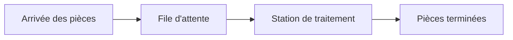
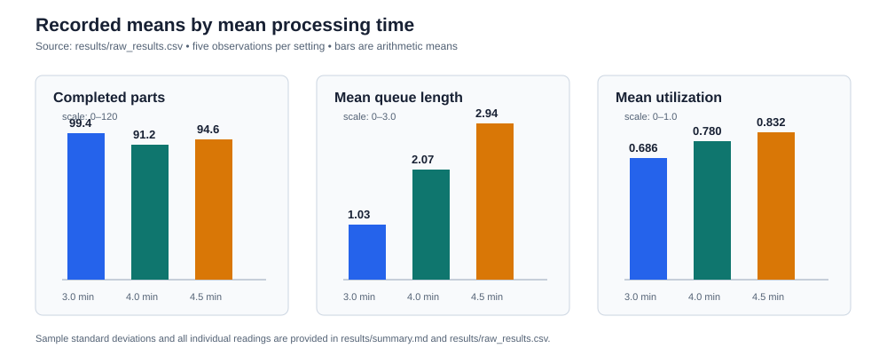

# Simulation d'une station de traitement de pièces

Ce dépôt présente un petit modèle de simulation à événements discrets construit avec AnyLogic. L'idée est simple : observer comment le temps moyen de traitement d'une pièce influence la production, la file d'attente et l'utilisation de la station.

L'objectif n'est pas de tirer des conclusions définitives avec très peu de données. Il s'agit plutôt de poser une démarche propre : conserver les résultats bruts, calculer des indicateurs, mesurer leur variabilité et expliquer clairement ce que les résultats permettent — ou non — de conclure.

## Fonctionnement du modèle

Le modèle fourni utilise la bibliothèque *Process Modeling Library* d'AnyLogic et l'unité de temps est la minute.

| Élément vérifié dans le modèle | Valeur / expression |
|---|---|
| Horizon de simulation | 480 minutes |
| Temps moyen entre arrivées | 5,0 min |
| Temps de service étudiés | 3,0 ; 4,0 ; 4,5 min |
| Arrivées | `exponential(1.0 / meanArrivalMin)` |
| Service | `exponential(1.0 / meanServiceMin)` |
| Paramètre aléatoire affiché dans AnyLogic | mode `Random seed`, valeur 42 |
| Pièces terminées | `sinkFinished.count()` |
| Longueur moyenne de file | `queueMachine.statsSize.mean()` |
| Utilisation moyenne | `delayMachine.statsUtilization.mean()` |

Le modèle source, conservé sans modification, est disponible dans [src/anylogic](src/anylogic).

## Résultats des 15 réplications relevées

Les données comprennent cinq réplications pour chacun des trois temps de service. Elles sont conservées dans [results/raw_results.csv](results/raw_results.csv). Le graphique ci-dessous représente seulement les moyennes calculées à partir de ces relevés.

| Temps de service moyen | Pièces terminées, moyenne | File moyenne | Utilisation moyenne |
|---:|---:|---:|---:|
| 3,0 min | 99,40 | 1,032 | 66,6 % |
| 4,0 min | 92,40 | 2,072 | 78,0 % |
| 4,5 min | 94,60 | 2,942 | 83,2 % |

Les calculs détaillés — moyenne, écart-type, quartiles et intervalles de confiance de Student à 95 % — sont présentés dans [results/summary.md](results/summary.md) et expliqués pas à pas dans [docs/analyse-statistique.md](docs/analyse-statistique.md).

## Comment lire ces résultats

Sur cet échantillon, la longueur de la file et l'utilisation moyenne augmentent lorsque le temps de service augmente. C'est cohérent avec le fonctionnement attendu de la station : si le traitement est plus long, la machine reste occupée plus longtemps et les pièces ont davantage tendance à attendre.

La production moyenne ne diminue pas de façon strictement monotone entre les trois scénarios. Avec seulement cinq réplications par scénario, cela ne permet pas d'affirmer qu'un scénario lent produit réellement plus. Les arrivées et les durées de traitement sont aléatoires, ce qui explique une partie des écarts observés.

## Limites et prochaine étape

Les cinq observations par scénario constituent un échantillon très limité. Les intervalles de confiance sont donc larges et doivent être lus comme une première estimation, pas comme une preuve définitive.

Pour améliorer l'étude :

1. Exécuter au moins 30 réplications par scénario comme premier objectif pratique.
2. Enregistrer la graine utilisée pour chaque réplication et vérifier leur indépendance.
3. Exporter systématiquement les résultats bruts en CSV.
4. Ajouter des barres d'incertitude aux graphiques.
5. Augmenter encore le nombre de réplications si les intervalles de confiance restent trop larges pour la précision recherchée.

## Organisation du dépôt

- [src/anylogic](src/anylogic) : modèle AnyLogic transmis.
- [results](results) : données brutes, synthèse statistique et graphique.
- [docs](docs) : description du modèle, méthode expérimentale et explication des calculs.
- [images](images) : emplacement prévu pour une future capture réelle de la simulation.

Aucune capture de simulation n'a été inventée. Les consignes pour ajouter une capture authentique sont dans [images/SIMULATION_SCREENSHOT_PLACEHOLDER.md](images/SIMULATION_SCREENSHOT_PLACEHOLDER.md).

## Licence

Aucune licence n'a été fournie avec le projet initial. Il faut en ajouter une avant toute réutilisation ou diffusion élargie.
