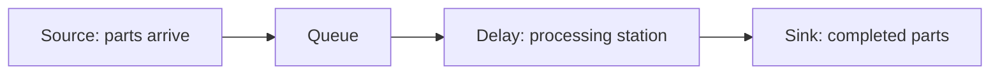

# Single-Station Parts-Processing Simulation

An AnyLogic discrete-event model of a single parts-processing station. The project examines how the mean processing time affects completed parts, the time-average queue length, and station utilization.

## Model at a glance

The model is implemented in AnyLogic Process Modeling Library and uses minutes as its time unit. It is intentionally small and suitable for learning, calibration, and controlled parameter experiments.

## Verified model configuration

| Item | Value in the supplied model |
|---|---:|
| AnyLogic project format | 8.9.10 |
| Simulation horizon | 480 minutes |
| Mean interarrival-time parameter | 5.0 minutes |
| Processing-time parameter values recorded | 3.0, 4.0, 4.5 minutes |
| Arrival-time expression | `exponential(1.0 / meanArrivalMin)` |
| Processing-time expression | `exponential(1.0 / meanServiceMin)` |
| Random-number setting | Fixed seed: 42 |
| Queue statistic | `queueMachine.statsSize.mean()` |
| Utilization statistic | `delayMachine.statsUtilization.mean()` |
| Output statistic | `sinkFinished.count()` |

See [model description](docs/model-description.md) for the model logic and [methodology](docs/methodology.md) for the experiment protocol and validation boundaries.

## Results

The handwritten log contains 15 observations: five runs for each processing-time value. Its transcribed data and summary statistics are included in [results/raw_results.csv](results/raw_results.csv) and [results/summary.md](results/summary.md). The chart shows the arithmetic means of those 15 recorded observations.

| Mean processing time (min) | Completed parts, mean | Mean queue length | Mean utilization |
|---:|---:|---:|---:|
| 3.0 | 99.40 | 1.03 | 0.686 |
| 4.0 | 91.20 | 2.07 | 0.780 |
| 4.5 | 94.60 | 2.94 | 0.832 |

These figures are a transcription of the supplied handwritten record; they are not generated or extrapolated by this repository. The model file does not define a 15-replication experiment, so the repository deliberately does not claim a fully reproducible replication sequence.

## Repository layout

- [src/anylogic](src/anylogic): the supplied, unmodified AnyLogic project.
- [results](results): raw transcription, computed summaries, and a chart derived only from those data.
- [docs](docs): model interpretation and experiment methodology.
- [images](images): reserved for project visuals, including the future simulation screenshot placeholder.

## Reproduce or extend the experiment

1. Install AnyLogic 8.9.10 or a compatible version.
2. Open [SstationDeTraitementDePièces.alp](src/anylogic/SstationDeTraitementDePièces.alp).
3. Run the `Simulation` experiment for 480 minutes.
4. Set `meanServiceMin` to 3.0, 4.0, and 4.5 minutes; retain `meanArrivalMin = 5.0` unless deliberately changing the design.
5. Record `sinkFinished.count()`, `queueMachine.statsSize.mean()`, and `delayMachine.statsUtilization.mean()` for every run.
6. To obtain independent replications, explicitly manage and record a distinct seed for each run, then export the raw results before recalculating the summaries.

A visual placeholder for a future screen capture is in [images/SIMULATION_SCREENSHOT_PLACEHOLDER.md](images/SIMULATION_SCREENSHOT_PLACEHOLDER.md).

## Limitations

- The supplied project has a fixed seed of 42 and only a standard Simulation experiment; its replication settings are not a complete experimental design.
- The provided record has no run identifiers, timestamps, or per-run seed values.
- No warm-up analysis, confidence intervals, or statistical comparison is claimed here.
- The uploaded image is the evidence for the transcription, but it is not republished to avoid treating a photographed notebook page as a formal generated output.

## License

No license was supplied with the original project. Add one before reusing or distributing the work.
